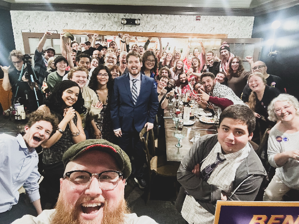
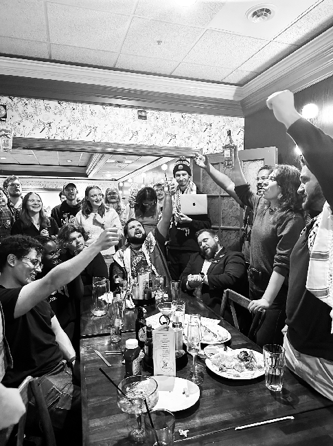
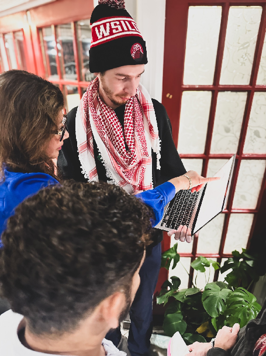
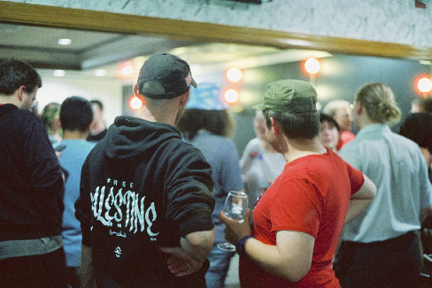
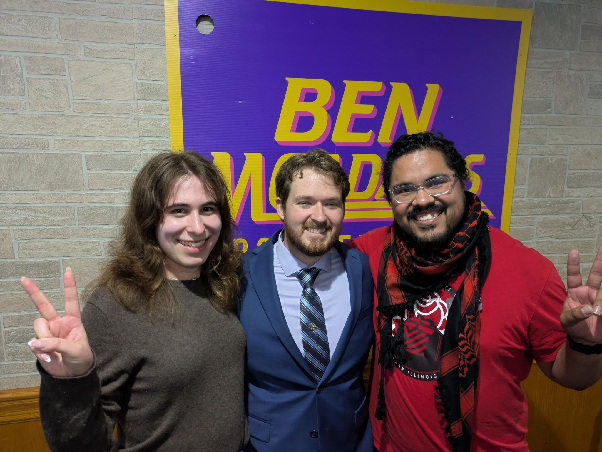

**Congratulations to Ben McAdams\!**  
*And why I’ve got the blue wave blues*

{:style="display:block; margin:0 auto;"}

Comrades, I’m not sure about you, but I had a great night on November 3rd.

First off, I’d like to congratulate my comrade, [Ben McAdams](https://www.mcadamsforil.com/), on being elected to the Illinois Senate District 24\. And I would like to thank every single member of WSIL DSA, campaign staff, and our community allies for their excellent work on this campaign. Roses for you, comrade.

### We’d have no people power without you.

As a Senator, Ben will work to advance a socialist agenda in Springfield. He will fight to tax billionaires and corporations to fully fund SNAP, Medicaid, and other services working people need. He will fight to reign in healthcare corporations profiting from denying care. He will invest in public safety by funding restorative justice rather than mass incarceration. He supports WSILDSA’s endorsed bills: the POWER Act to regulate data centers and the Human Rights Advocacy Protection Act to end Illinois’ complicity in the Gaza genocide. In short: this is a massive victory for working people in SD-24 and all of Illinois.

It was so special to spend election night with my comrades. The energy that night was electric as friends and comrades watched results come in, not only from progressives in Illinois and Michigan but also democrats in Texas and Mississippi. But I can’t help but have mixed emotions about our blue wave.

{:style="display:block; margin:0 auto;"}

### I’m DSA because the Democratic Party *isn’t enough*.

It’s good for us to celebrate the win in SD24. We put in the elbow grease for it. But a blue wave in and of itself isn’t worth a toast. Seeing people celebrate the Democratic Party is why I’ve got the blue wave blues.

It’s been a tension over the last 10 years: as fascism advances in the USA, to what extent are bland, uninspiring centrist Democrats useful to stop the overt racism and the pedophilic-capitalist class character of the Republican party?

We want to both stop the worst injustices currently happening and win the world we need. In some sense, these two aims are not actually in conflict. Socialists with vision are the best candidates to defeat Republicans (SD-24 proves it). And while Republicans are responsible for some of the most drastic injustices (e.g. gutting of social safety nets, ICE terror, and the war with Iran), Democrats also have proven willing to serve corporate donors before constituents (e.g. Gaza, or the failure to pass Medicare for All and the PRO Act).

The ultimate issue is that the Democratic Party remains largely captured by the same capitalists who finance the Republicans. If you buy both parties, then you don’t need to be worried about vote totals. 

{:style="display:block; margin:0 auto;"}

Of course, you and I are sweating vote totals because I know there are some who are not bought. It’s easy to see the crest of the blue wave: anyone can google the new makeup of Congress, the Illinois General Assembly, county boards, etc. Working people are being carried by that wave too – Ben McAdams is just one example. But it’s much harder to see how far we rose.

In DSA, we take endorsements seriously. We are very aware of the challenges of being a socialist in a government that has been captured by corporate interest via lobbyists, bought politicians, or Democratic party bosses, and legislation hostile to democratized control of the economy. That’s why we show up with people-power to support our candidates so that they remember to pick up our calls and co-govern with us once elected. We call it “the DSA difference.” [So let’s look at the results](https://2026.electoral.dsausa.org/).

{:style="display:block; margin:0 auto;"}

<small>*Photo Credit: Jules*</small>

On Tuesday, the DSA elected 11 DSA-endorsed socialists to Congress. We elected Ben McAdams and 52 other DSA-endorsed socialists to state legislatures. We passed 29 DSA-endorsed statewide ballot initiatives and 10 DSA-endorsed local ballot initiatives. And we elected 45 DSA-endorsed candidates to local office. 

DSA isn’t the only movement organization. A lot of progressives put blood, sweat, and tears into electing Dr. Abdul El-Sayed, for instance. But the difference is that rather than being funded by big donors and led by staff, DSA is a bottom-up, democratic organization of working people. DSA knows that collective ownership of the economy is what we need and we’re not afraid to be called socialists. It’s what we are.

GOP and Democratic politicians are accountable to their donors. But when politicians are accountable to DSA, they are accountable to the working class itself\! That may seem to be a bold claim, but DSA is this country’s largest organization truly and wholly owned by working people and explicitly socialist. Each time a member joins, we make good on the claim to represent the American working class. 

### Do it today at [DSAusa.org/join](http://DSAusa.org/join)

However, the issue is that the most visible divide in politics is between the old parties, which as we know is a false binary. In order to truly pave the way for legible, mass politics there must be a truly proletarian party wholly owned by working people. I believe DSA is the kernel of that party. But of course, the old parties jealously guard ballot access and benefit from first-past the post. Currently, DSA functions with one foot in and one foot out of the Democratic Party. We call this the “party surrogate.” We run on the Democratic ballot line. We use Democratic Party software (Votebuilder). We court Democratic voters. 

However, we also function as an independent body. We allocate our resources according to the will of our members rather than the beck and call of party bosses. And we are developing our own base of voters, donors, staff, candidates, and organizers apart from the party apparatus. This process of slow independence-building is known to DSA sickos as “the dirty break.”

{:style="display:block; margin:0 auto;"}

<small>*Photo Credit: Jules*</small>

The question is: when? When can we be truly independent? My answer is that we must be confident that we will precipitate a national political realignment. One option some of my comrades favor is to realign the Democratic Party into a proletarian party. They say it is the path of least resistance: the Party already has a base of voters, organization, reputation, and expertise. On a practical level, let me point out: just as there is no lever to decisively remove the DSA from the Democratic Party, we have no lever to decisively remove corporate candidates from the Democratic Party. The Party might already have a structure, but the structure that exists is essentially a caucus of elected officials and their hangers-on organizing in their own interest to maintain their positions. That is precisely the opposite of what we need\! The Party has a base of voters (and donors), but are they organized to want transformation of the economy and society? Not yet: it is the socialist movement’s work to show them what a transformed society could look like. And as for expertise, the Party has is the “wisdom” of the consultant telling Kamala Harris to campaign with Liz Cheney.

There is another piece of organizing jargon: the prefiguration thesis. Essentially, it's the idea that the structure of the revolutionary organization must prefigure the structure of the state it aims to create. I aim to build a society owned by working people and controlled democratically, which is why I organize with a democratic organization of working people. 

We can be an independent party once we've built enough power to be confident in our ability to eclipse one of the existing old parties. I think we will know it’s time when corporate Democrats accelerate reaching across the aisle or fleeing to the Republicans. It may have already begun with Haley Stevens’s flight, but it will take a lot of organizing to precipitate similar conditions nationwide.

Each member builds our pool of collective energy. Each door knocked gets us closer to an electoral win. Each leader developed brings our message to new communities. Each time ICE activity is monitored or a comrade is trained our street power grows. Each candidate elected gets us closer to a majority. And each reform passed chips away at the massive edifice the billionaire capitalist class has arrayed against us. We have a long way to go, but every day the lines of the people move forward.

{:style="display:block; margin:0 auto;"}

<small>*Photo Credit: Jules*</small>

Congratulations Ben. I’ll toast to the next one. And the next, and the next, and the next, until the world belongs to us. I’ll be seeing you, comrades.  
