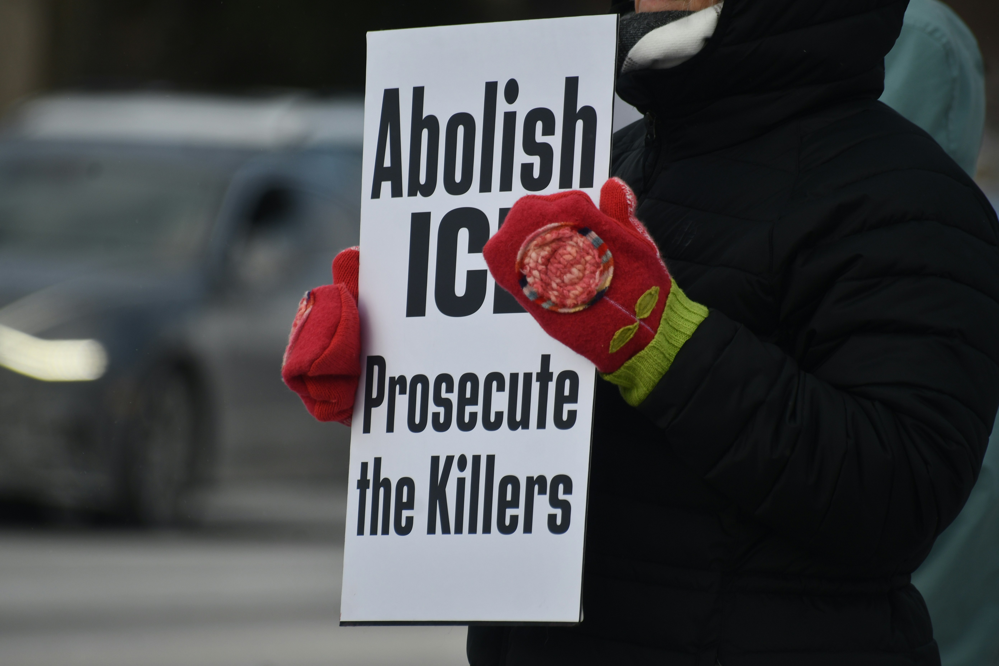
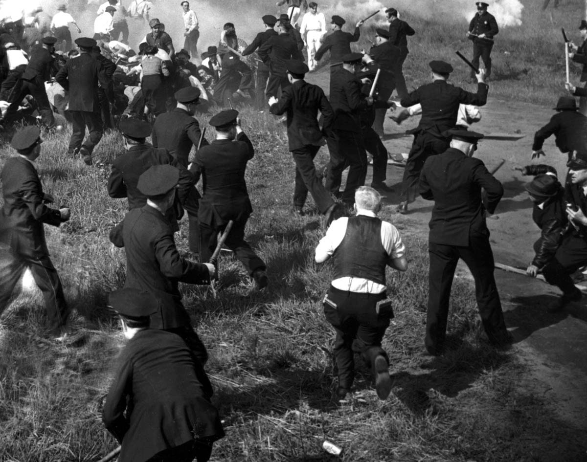

# Abolishing ICE Is Just the First Step

## A discussion on what needs to come after abolishing ICE

<small>Photo by Meg on Unsplash</small>

A recent phrase among many in the fight against fascism has been: “Abolish ICE.” While this phrase accurately portrays the explicit goals of the abolish ICE movement in America, abolishing ICE is just the first step in the long path towards freedom for immigrants.

ICE, or Immigration and Customs Enforcement, operates as a federal agency throughout the United States. Although it acts in partnership with CBP (Customs and Border Protection), DHS (Department of Homeland Security), and local law enforcement agencies, ICE has been the de facto institution in Trump and the U.S. federal government’s goal to purge the U.S. of immigrants.

To support this work, the budgets of both ICE and CBP ballooned in Trump’s second term. Subsequently, both institutions have begun to hire many new officers and rapidly expand operations throughout the country. As part of 2026’s Secure America Act, ICE received \$38 billion to be used by the end of 2029, and CBP received \$22 billion([^1]). The budget increase is a telling sign that we can expect more raids, impunity, and terror ahead.

Alongside ICE’s expanded headcount and operations, the agency has increasingly militarized its staff, even culminating in the purchase of gloves that can deliver painful electrical chocks to the detainee. ICE just granted a \$16.7 million no-bid contract to Compliant Technologies LLC for thousands of these gloves to be used to “de-escalate” on the streets([^2]). Beyond the cruel use of force, using harmful devices and techniques to de-escalate situations has proven counterproductive in the past. Since ICE became the Trump administration's chosen institution, we’ve seen decreased training requirements for new officers, leading to unvetted and unqualified agents on the ground. This has led to officers who are too eager to use force and bring about increased incidents of violence. Perhaps this shows us their actual intent: they don’t mean to de-escalate conflict or simply uphold immigration law; they only mean to push their way through communities, harm them, and move our country further into fascism.

ICE and CBP were established as federal agencies in 2003, during the Bush administration. In the wake of 9/11, the federal government reorganized its immigration policy using the Homeland Security Act of 2002, which created ICE and CBP as a consolidation of smaller existing agencies. The stereotype that immigrants are criminals is commonplace in the U.S., but after the 9/11 attacks, immigrants evolved from simply criminals to terrorists. We hear this rhetoric frequently from politicians, most notably Trump, with virulent statements like: “Mexico is not sending their best” or  “Immigrants are poisoning the blood of our country.” He also has banned travel from countless countries during his two terms in office. We also see this change in the way our federal government funds and operates its immigration policy, from the increased funding after 9/11 to the building of a border wall.

With all the chaos the Trump administration is causing in our communities through ICE and CBP, what is to be done? Yes, we need to work to abolish ICE, but ICE is not the only agency responsible for this pain. ICE, CBP, DHS, and any other federal agency that seeks to bring disproportionate violence against innocent immigrants and communities must be abolished. This even extends to local law enforcement, which in almost every municipality has decided to work with immigration enforcement, even in places where they are not permitted to do so by local law.

<small>*This photograph shows Chicago Police opening fire on striking steel mill workers at Republic Steel during the incident known as the Memorial Day Massacre in 1937\. (From National Archives and Records Administration used in the papers of the La Follette Committee)*</small>

But abolition is not enough. As we’ve seen with the creation of ICE and CBP, new institutions can always be formed to enact violence. In that same vein, existing institutions can receive increased funding and expand to assume a role never intended for them. Immigration enforcement and local law enforcement are similarly tied to the goals of capitalism, whether it’s by regulating labor markets, generating corporate profits for companies in the military-industrial complex, or acting as tools for the political goals of the bourgeoisie. These institutions serve to protect private property and the profits of the billionaire class by containing class antagonisms, rather than protecting human rights and the working class. To prevent this cruelty from happening in the future, we need to bring about structural change. This means working towards democratizing our country in real ways–in individual workplaces, in major industries, and in the way our government, both local and federal, operates; in other words, working towards a socialist future. To begin that work, we must start with a broad abolition of law enforcement at both the local and federal levels.

After abolishing these agencies and bringing about further structural change, participants in these operations, from the administrative to the enforcement level, need to be prosecuted for the crimes they’ve committed. Individuals within these agencies, and these agencies as a system, both violate local, federal, and international law. Arresting individuals on their way to a courthouse, preventing lawyers from contacting their clients, shooting innocent people on the streets, and using militarized weapons on citizens and immigrants are just a small sampling of the most publicized controversies. Those who have committed these crimes must be prosecuted, and rigorous investigations and transparency must ensure that these tactics are not deployed again. We must make it known to all future law enforcement that “just following orders” is never a viable defense for committing crimes such as these.

The effects of the terror brought by ICE are broadcast on a near-daily basis. What is underreported, however, is the normalization of violence and the issues it brings. This normalization of violence helps facilitate our nation's progression into fascism, so it must be condemned. This is where organizers can work every day to limit the harm brought by immigration enforcement. Condemning and organizing against ICE’s violence begins with having difficult conversations with friends and family, condemning the violence and cruelty of immigration enforcement at home. Furthermore, we must achieve this end through protesting on the streets, protecting our neighbors through organizing and helping rapid response teams, educating the masses, and organizing others around the struggle. The road ahead is long, but individual and organized resistance and everyday conversations will lead to change.

While the Trump administration is currently weaponizing these agencies for public display, the use of immigration enforcement as a tool to uphold the oppressive systems we live under has been a constant under administrations of both parties. The scope and scale of the failures of ICE and immigration enforcement in the U.S. are deeply ingrained in these institutions. It will take structural, not just institutional change, to end the terror these institutions bring to our streets and to bring about a more fair and just world. Not a world where capital is protected at all costs, but one predicated on the idea that everyone deserves to live a safe and prosperous life, and one centered around people’s humanity.

### [Join WSILDSA](https://wsil.dsachapters.org/) today to create not only a better Illinois, but a better and safer world. 

---

([^1]: https\://www\.npr.org/2026/06/09/nx-s1-5851664/house-reconciliation-vote-immigration-enforcement-ice-border-patrol)
([^2]: https\://www\.cbsnews.com/news/ice-electric-shock-glove-16-7-million-contract/)
